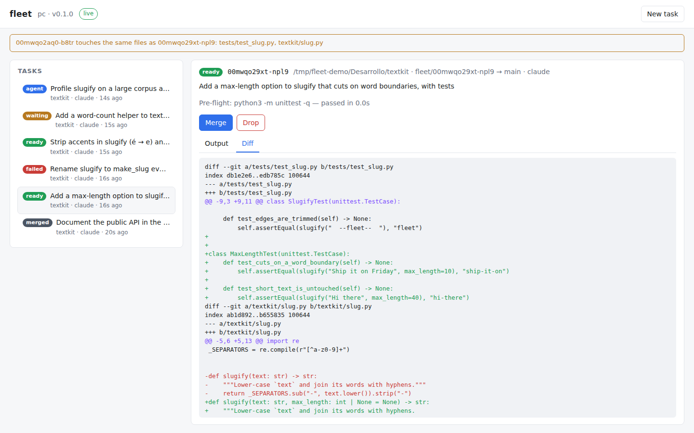
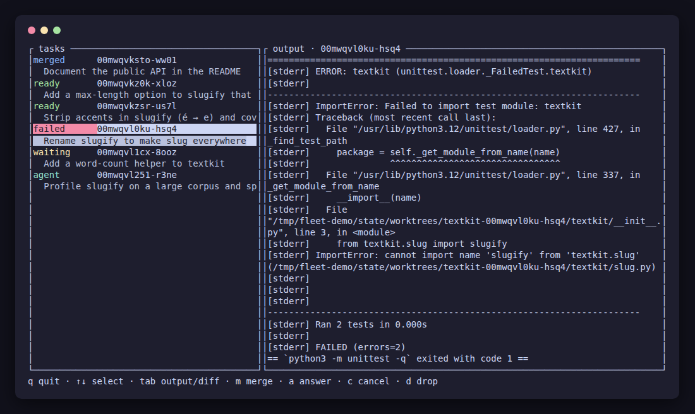

# fleet

Run several coding agents at once, each in its own git worktree, and only integrate what passes the repository's own tests — across your machines, over Tailscale.



## What it is

Coding agents such as Claude Code are good at one task at a time in one checkout. Running three of them in the same repository means they trample each other's files, leave half-finished branches around and push changes nobody tested. Running them on two machines means remembering where each one is.

fleet is a small daemon plus a CLI, a terminal UI and a web view that turns "ask an agent to do X" into a tracked task:

- every task gets a fresh **git worktree** on its own branch, cut from a freshly fetched `origin/<base>`;
- the **agent** works there (the `claude` or `agy` CLIs on their subscriptions, or a local Ollama model);
- before anything is integrated, a **pre-flight** runs the repository's own tests inside that worktree;
- fleet **warns when two tasks touch the same files** and integrates them in order;
- integrating means **rebase, test again, push without force**. Red tests or a conflict leave the branch where it is, with the reason;
- one daemon per machine; the daemons find each other on the **tailnet** and place each task where it fits (Xcode work on the Mac, GPU work on the PC, the rest where there is room).

No paid LLM API is ever called: fleet refuses to run an agent that authenticates with an API key instead of a subscription.

## What makes it interesting

- **A real state machine around a fragile process.** Tasks move through `provisioning → agent ⇄ waiting → preflight → ready → merged` (or `failed`/`dropped`), persisted in SQLite. After a crash or a reboot, `fleetd` reconciles what was running with what is on disk instead of guessing.
- **Process hygiene.** Agents, tests and git all run with a deadline, in their own process group, and are killed as a group when cancelled. Logs are streamed line by line to disk and to live subscribers.
- **Safety by default.** The daemon only binds to loopback and refuses anything else at startup. Sharing goes through `tailscale serve`, and writes over the tailnet require the identity header of the machine's owner. A guard against DNS rebinding and cross-site requests stops any web page open in your browser from launching agents.
- **Tests decide, not the agent.** A repository without a known test command never goes green. The pre-flight runs again after the rebase, so what lands on `origin` is what was tested.
- **Real git in the tests.** Worktree, rebase, conflict and push tests run against throwaway repositories with a bare `origin`, not mocks.

## How it works

```
             fleet (CLI / TUI)        browser (web view)       other clients (HTTP)
                     │                        │                         │
                     └──────────── HTTP + SSE on 127.0.0.1:7171 ────────┘
                                              │
                                           fleetd ──── SQLite (tasks), logs
                                              │
               ┌──────────────┬───────────────┼───────────────┬──────────────┐
          git worktree     agent CLI      pre-flight      overlap check   integration
          fleet/<id>     (claude, agy,   (cargo test,     (files touched  (rebase, tests,
                          Ollama)         pytest, …)       by each task)   push, no force)
                                              │
                         tailscale serve ─────┴───── fleetd on the other machine
```

1. `fleet run "<prompt>"` creates a task. fleetd fetches `origin`, creates the worktree and starts the agent with a short preamble: work only here, commit, never push, and end with `QUESTION: …` if a decision is needed.
2. If the agent asks something, the task waits in `waiting`. `fleet answer` resumes the same agent session with the reply.
3. When the agent finishes, its diff is recorded and the pre-flight runs. Green means `ready`; red means `failed`, with the tail of the test output.
4. Any two live tasks on the same repository and base that change the same file are reported as an overlap. The newer one cannot be merged until the older one is done.
5. `fleet merge` rebases the branch onto the latest `origin/<base>`, runs the tests again and pushes. If `origin` moved in the meantime, it tries again; if the rebase conflicts or the tests turn red, nothing is pushed and the branch stays.

## Screenshots

The terminal UI, showing the end of a pre-flight that failed because the agent renamed a function without updating its callers:



## Repository layout

```
crates/
├── fleet-core/     the library: no network, no HTTP
│   └── src/
│       ├── task.rs         task ids, specs and the state machine
│       ├── store.rs        SQLite persistence
│       ├── worktree.rs     create, diff and remove worktrees and branches
│       ├── agent.rs        how claude, agy and Ollama are invoked and resumed
│       ├── transcript.rs   reads the agents' JSON output (session, result, quota, API keys)
│       ├── runner.rs       runs an agent with a deadline and records its log
│       ├── preflight.rs    finds and runs the repository's tests (and optionally `act`)
│       ├── integrate.rs    rebase, test again, push without force
│       ├── overlap.rs      overlap detection and integration order
│       ├── placement.rs    which node can run a task (Xcode, GPU, load)
│       ├── tailnet.rs      parses `tailscale status --json`
│       ├── recovery.rs     reconciles running tasks after a restart
│       └── process.rs      child processes with deadlines and process groups
├── fleetd/         the daemon
│   ├── src/
│   │   ├── engine.rs       background jobs per task and the event stream
│   │   ├── api.rs          the axum HTTP API and SSE
│   │   ├── guard.rs        Host/Origin checks and tailnet identity
│   │   ├── nodes.rs        discovery and health of the other machines
│   │   ├── proxy.rs        forwards /v1/nodes/<node>/... to another fleetd
│   │   └── web.rs          serves the embedded web view
│   └── web/                index.html, app.js, app.css (no build step)
└── fleet/          the CLI and the terminal UI (ratatui)
docs/
├── api.md          HTTP API reference
└── decisions/      architecture decision records
```

## Requirements

- Rust 1.89 or newer and a C compiler (SQLite is built from source).
- Git.
- At least one agent: [Claude Code](https://docs.anthropic.com/en/docs/claude-code) (`claude`) logged in with a subscription, `agy`, or [Ollama](https://ollama.com) running locally.
- Linux or macOS. On Windows, run it inside WSL2.
- Optional: [Tailscale](https://tailscale.com) with Serve and HTTPS certificates enabled, to use more than one machine; [`act`](https://github.com/nektos/act) and Docker, to replay a GitHub Actions job in the pre-flight.

## Installation

```sh
git clone https://github.com/juanmmm21/fleet.git
cd fleet
cargo install --path crates/fleetd
cargo install --path crates/fleet
```

Start the daemon (or run it as a systemd user service or a launchd agent):

```sh
fleetd                      # listens on 127.0.0.1:7171, state in ~/.local/state/fleet
```

## Usage

From inside a repository whose `origin` you can push to:

```sh
$ fleet run "Add a max-length option to slugify that cuts on word boundaries, with tests"
$ fleet ls
00mwqvksto-ww01  merged        claude            textkit         Document the public API in the README
00mwqvkz0k-xloz  ready         claude            textkit         Add a max-length option to slugify that cuts on word bounda…
00mwqvl0ku-hsq4  failed        claude            textkit         Rename slugify to make_slug everywhere
00mwqvl1cx-8ooz  waiting       claude            textkit         Add a word-count helper to textkit
```

The rest of the commands:

```sh
fleet log <id> --follow     # live output until the task needs you
fleet show <id>             # state, failure reason, question, pre-flight result
fleet diff <id>             # what the agent changed
fleet answer <id> Use the existing helper in utils.py
fleet merge <id>            # rebase, test again, push
fleet cancel <id>           # stop it; the branch and the worktree stay
fleet drop <id>             # discard it; the branch and the worktree are deleted
fleet tui                   # the terminal UI
```

Choose the agent with `--agent claude|agy|ollama[:MODEL]` and `--model`, the branch with `--base`. Every command takes `--json` where it prints a task.

The web view is served by the daemon at `http://127.0.0.1:7171/`. It shows the same tasks live, with their output, diff and overlap warnings, and lets you create, answer, merge, cancel and drop them. It also works on a phone.

### Telling fleet how to test a repository

fleet detects a `Makefile` with a `test` target, `Cargo.toml`, `package.json` with a real test script, pytest projects, `go.mod` and `Package.swift`. Detected pytest projects run with `PYTHONPATH` and `MYPYPATH` set to the worktree's `src/` (if any) and its root, so a package installed in editable mode in the linked `.venv` is tested from the task's code, not from your checkout. To be explicit, or to replay a CI job with `act` after the native tests pass, add a `fleet.toml` at the root of the repository:

```toml
[preflight]
command = ["python3", "-m", "unittest", "-q"]
timeout_secs = 120

[preflight.act]
job = "test"
args = ["--container-architecture", "linux/amd64"]
```

### Two machines

Run `fleetd` on each machine with a name and share it on the tailnet only:

```sh
fleetd --node pc --gpu                                     # the machine with the GPU
tailscale serve --bg --https=443 http://127.0.0.1:7171
```

Each daemon discovers the others with `tailscale status` and checks their health every 30 seconds. Then:

```sh
fleet run --node auto --repo textkit "…"      # Xcode work → macOS, Ollama → --gpu, else the least busy
fleet run --node mac  --repo textkit "…"      # a given machine; the repo goes by name (~/Desarrollo/<name>)
FLEET_NODE=mac fleet ls                       # the tasks of another machine, through the local daemon
```

A machine that is asleep is shown as offline and its tasks resume when it wakes up.

### Using fleet from another program

Everything above is a small HTTP API with server-sent events, documented in [docs/api.md](docs/api.md). A client that needs to launch the agent itself (its own tools or quota handling) creates the task with `"agent": {"kind": "external"}`: fleet creates the worktree, the client works and commits there and calls `POST /v1/tasks/{id}/done`, and fleet runs the tests, warns about overlaps and integrates as usual. A `client` label lets it find its tasks again with `GET /v1/tasks?client=<label>`.

The design decisions behind the crates, the API and the multi-machine setup are in [docs/decisions](docs/decisions).

## Development

```sh
cargo fmt --check
cargo clippy --all-targets -- -D warnings
cargo test
```

The tests use a fake `claude` and real git repositories in temporary directories; some start real `fleetd` instances on ephemeral ports. CI runs the same three commands on Linux and macOS.

## Troubleshooting

- **`no test command found`**: the repository has none of the files fleet recognises. Add a `fleet.toml` with `[preflight] command = [...]`. fleet will not mark a task green without tests.
- **A task failed with "claude is authenticated with ANTHROPIC_API_KEY, which is billed per use"**: the `claude` CLI picked up an API key from the daemon's environment. Remove it so the subscription is used.
- **`403 forbidden` from the web view or another machine**: you reached the daemon through a host name it does not trust, or as a different Tailscale user. Add the name with `--allow-host` or the user with `--allow-login`.
- **`node_offline`**: the other machine is asleep or its `fleetd` is not running. `GET /v1/nodes` shows what each daemon sees.

## License

MIT. See [LICENSE](LICENSE).
